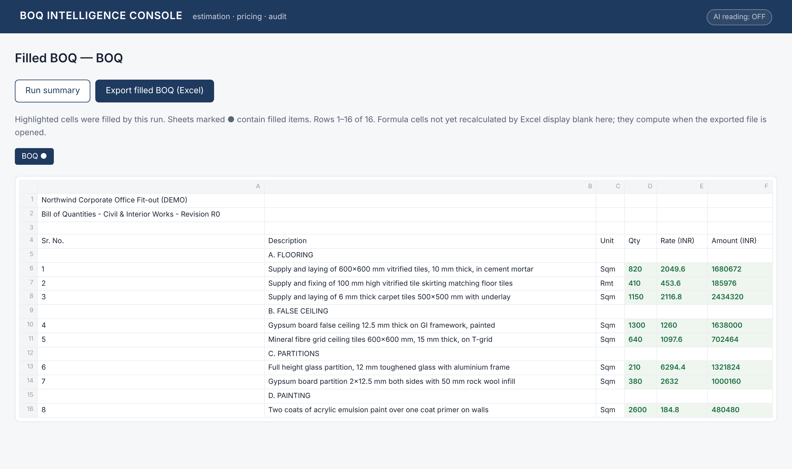
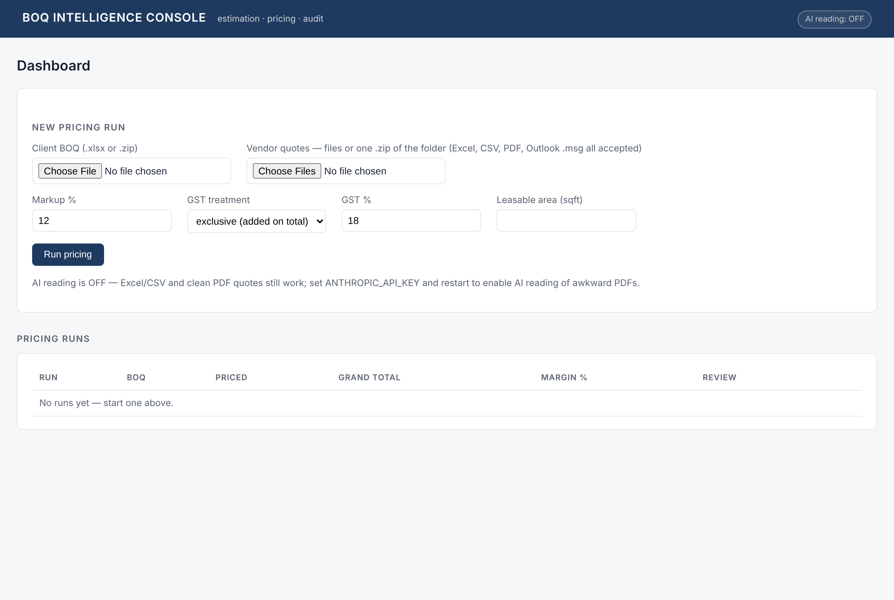
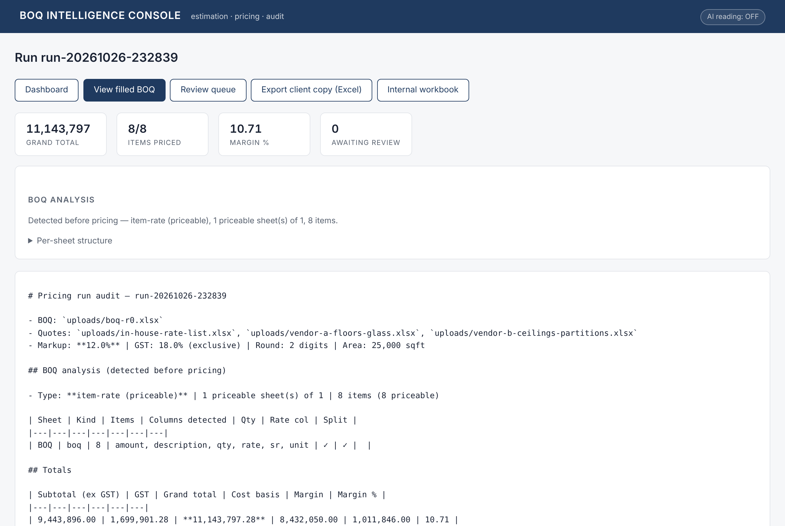

# BOQ Pricing Agent

**Turns a construction tender's Bill of Quantities and a pile of vendor quotes into a priced, margin-checked bid — with an audit trail for every number.**

   



---

## The problem

In design-and-build and interior fit-out firms, every tender is priced by hand in Excel:

1. The client sends a BOQ (often hundreds or thousands of line items across many sheets).
2. Items are floated to vendors; quotes come back in every possible layout — some split supply and installation, some give only amounts, some are bare price lists.
3. An estimator matches each quote line to the right BOQ item by description *and* specification, picks the lowest (L1) rate, applies markup with the firm's `ROUND` convention, and fills the client's file without breaking its formatting.
4. Then the client re-issues the BOQ, or asks for a target total, and it starts again.

It is slow, and one wrong match silently corrupts the offer.

## What this does

| Step | What the agent does |
|---|---|
| **Read** | Detects BOQ / quote / rate-list / notes sheets, finds header rows (incl. multi-row headers), extracts items with qty, unit, supply, install and total rates |
| **Match** | Deterministic spec matching (size, thickness, unit aliases, Sr-No alignment); low-confidence matches go to a **human review queue** — never guessed |
| **Price** | L1 on supply + installation totals → `ROUND(L1 × (1 + markup), 2)` → amount, GST inclusive/exclusive, ₹/sqft per package |
| **Write back** | Two outputs from one run: the **client copy** (original file, formatting untouched, values only, metadata scrubbed) and an **internal workbook** (live formulas, vendor comparison, margin per item) |
| **Revisions** | Diffs BOQ R0 → R1: unchanged / qty-changed / spec-changed / added / removed, carries rates forward |
| **Negotiation** | Back-solves the markup % that hits a client's target total and warns when margin drops below a floor |
| **Audit** | Markdown/HTML report explaining every rate: candidates, chosen vendor, base, markup, final rate |

Design rule: **all arithmetic is deterministic Python.** An optional Claude API pass only helps read messy sheets and suggest matches; every number it points at is re-read from the file.

## Try it in 2 minutes

```bash
pip install -r requirements.txt
python examples/make_demo_tender.py          # builds a synthetic tender pack
python -m boq.cli fill examples/demo-tender/boq-r0.xlsx \
    --quotes examples/demo-tender/quotes/*.xlsx --markup 12 --area 25000
python -m boq.cli diff examples/demo-tender/boq-r0.xlsx examples/demo-tender/boq-r1.xlsx
python -m pytest tests -q
```

Web UI (upload, review queue, filled-BOQ viewer, downloads):

```bash
uvicorn boq.webapp:app --port 8000     # or: bash setup.sh && bash run-app.sh
```

| Dashboard | Run summary |
|---|---|
|  |  |

## Demo result (synthetic tender, 8 items, 3 quote files)

| Subtotal ex-GST | Cost basis (L1) | Margin | ₹/sqft | Items priced | Review queue |
|---|---|---|---|---|---|
| ₹94.44 L | ₹84.32 L | 10.71 % | 377.76 | 8 / 8 | 0 |

Ask it to hit ₹1.05 Cr all-in and it back-solves markup to 5.53 % — and flags that margin has fallen under the 8 % floor.

## How it was built

I mapped the estimation workflow from the inside — how estimators actually float, compare, round and revise — wrote the rules down as a spec (what must never happen, what goes to human review), and built the tool with **Claude Code** as my engineering pair, milestone by milestone, each one gated by tests. The private development suite (87 tests) ran on real, anonymised tender files; this public version ships only invented data and its own test suite.

## Project layout

```
boq/            ingest · extract · match · specmatch · price · diff · float_pkg · writeback · report · webapp · cli
examples/       make_demo_tender.py — synthetic BOQ R0/R1, two vendor quotes, an in-house rate list
tests/          end-to-end tests on the demo tender
docs/           screenshots
```

---

Built by **Yashwant Kumar Gurjar** — I design and build AI tools for operations-heavy businesses.
[Portfolio](https://yashkasana1996.github.io) · [LinkedIn](https://linkedin.com/in/yashwant-gurjar96) · yashkasana6991@gmail.com

*All names, items and rates in this repository are fictional.*
